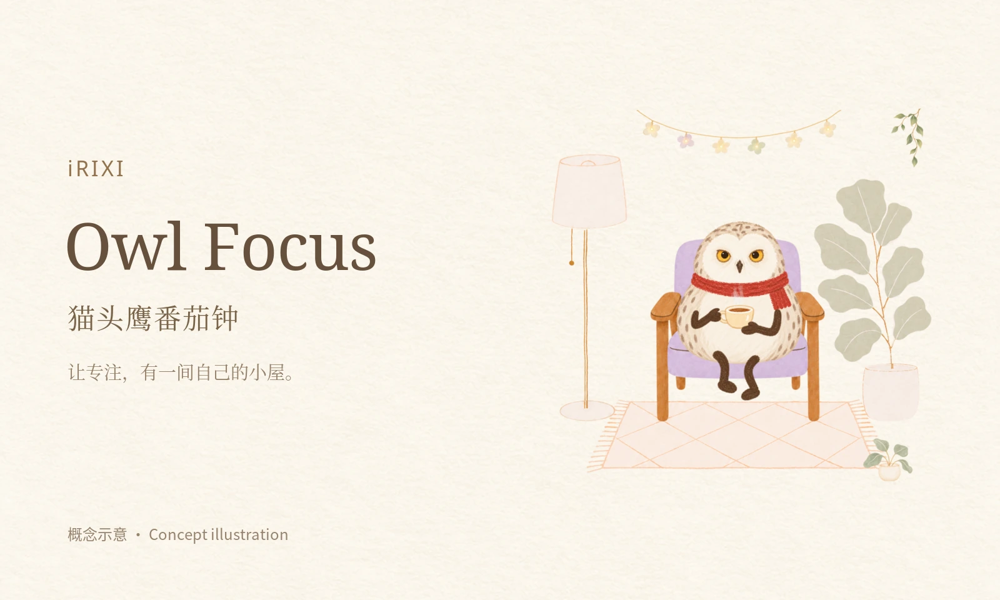
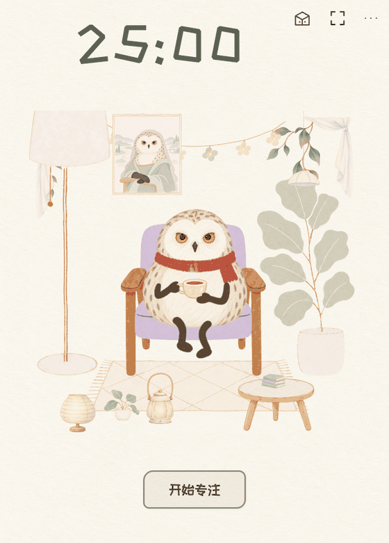

# IRiXi Owl Focus · 猫头鹰陪伴式番茄钟

[简体中文](README.md) · [English](README.en.md)

写下一件事，和红围巾猫头鹰一起专注。积累专注时间，收藏装饰，把房间慢慢布置成自己喜欢的样子。

A cozy desktop Pomodoro timer with an interactive owl companion, focus rewards and a customizable room.

[功能一览](#可以做什么) · [从源码运行](#从源码运行) · [数据与使用限制](#本地数据与当前边界) · [反馈问题](https://github.com/Irixil/irixi-owl-focus/issues)

项目创作者：[IRiXi](https://github.com/Irixil)。这是独立番茄钟仓库；如果还想要截图翻译、剪贴板和待办笔记，可使用 [IRiXi Mac 灵动岛工具箱](https://github.com/Irixil/IRiXi-Toolbox)。两个版本的存档独立，不自动同步。



*产品概念示意，由本项目既有艺术素材合成，不是应用截图。*

## 看看它怎么用



*早期版本实机演示，使用隔离示例数据及“全道具体验”，不代表真实专注解锁。未展示后续全部布置功能；[演示来源与范围](docs/images/demo-sources.md)。*

## 可以做什么

- **陪你完成一轮专注**：设置任务与时长，开始、暂停、继续或结束。猫头鹰会眨眼、喝茶，点一下也会回应；可以开启减少动效。
- **随时准备下一轮**：当前轮没完成也能开始下一轮；下一轮默认时长可随时保存，不改变本轮进度。提前结束只保留实际有效专注时间。
- **让专注留下积累**：每满一分钟有效专注得到成长印记；累计5分钟解锁圆眼镜，10分钟解锁阅读椅。暂停、休息和离线时间不增加成长。
- **布置自己的房间**：试摆灯、地毯、植物、挂画、桌子和其他装饰，拖动位置、按比例缩放，调整适用物件的方向及前后关系。
- **试好再保存**：点“放好”保存整组布局，取消恢复原搭配。全道具体验单独保存，不增加真实专注时间或永久收藏。

房间支持不同窗口尺寸；收藏箱保留道具和已保存的布置。更多布置细节、当前验证范围见[房间适配说明](docs/room-camera-v56.md)和[开发与验证记录](docs/development-history.md)。

## 从源码运行

当前提供源码启动方式，尚未发布可直接下载的通用签名安装包。已验证范围以 macOS arm64 为主，其他平台尚未验收。界面目前主要为简体中文。

需要 Node.js 22.12 或更高版本，Electron 固定为44.0.0：

```sh
git clone https://github.com/Irixil/irixi-owl-focus.git
cd irixi-owl-focus
npm ci
npm start
```

第一次用，可以先填一个任务并开始计时，再打开“更多 → 收藏与装扮”试摆一个物件，最后点“放好”保存。

想直接试用已有道具：

```sh
npm start -- --test-all-items
```

此参数只在尚未选择过测试开关时默认开启，之后尊重已保存的开关，也可在“更多 → 收藏与装扮”中切换。测试布置与正常装扮、永久收藏独立。

## 本地数据与当前边界

专注进度、收藏和房间布置保存在本机。独立版与工具箱使用不同存档，不自动同步；开发或测试可用 `OWL_FOCUS_DATA_DIR` 指向另一个目录。旧存档升级前保留原字节备份，损坏存档会停止并提示，不能用空进度覆盖。

应用重开或检测到中断后，未完成的一轮先暂停，等你确认继续，不补计离线时间。

独立版尚未接入真实前台 APP 查询，记录入口保持关闭。当前没有手机端、App Store 上架或长期记忆功能。整机真实睡眠与长期后台运行未完成全部验证，计时也不等于实际任务已经完成。

既有检查包含计时、布局保存与恢复、独立入口和工具箱内嵌场景，但范围不同。历史结果保留在[验证说明](docs/verification.md)及[开发记录](docs/development-history.md)，不把本次 README 调整当作功能重新验收。

## 开发检查

```sh
npm test
npm run verify:ui
npm run verify:reopen
npm run verify:room
npm run verify:durations
npm run verify:durations-reopen
```

## 素材与许可

角色和房间使用本项目生成并确认的艺术素材，概念主图沿用这些素材排版合成。界面字体为站酷快乐体，罕见字回退霞鹜文楷；随仓库保留各自 SIL OFL 1.1 许可。详见[素材与来源](docs/assets.md)、[概念图来源](docs/images/concept-sources.txt)及[作者与推荐署名](ATTRIBUTION.md)。

本项目自身源码和美术仍为 **UNLICENSED**。公开仓库不代表授予开放源码或艺术素材授权，第三方字体和依赖分别按其许可证使用。本次展示优化不改变许可。
